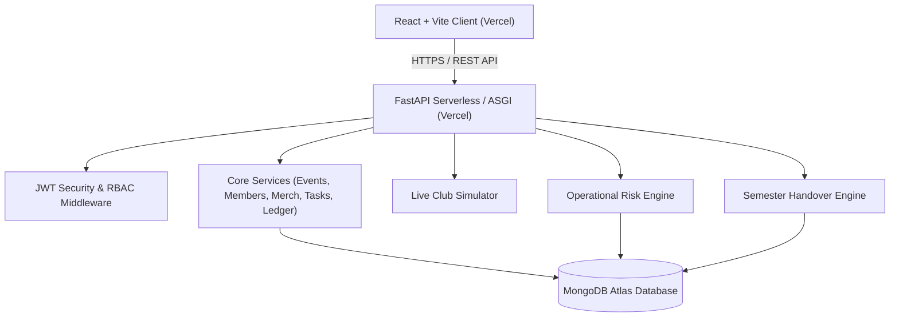

# ClubPulse System Architecture

## 1. High-Level Overview
ClubPulse is an **Intelligent Student Organization Operating Platform** designed for universities, student chapters, and collegiate societies. Unlike traditional CRUD dashboards or ungrounded AI chatbots, ClubPulse incorporates:
1. **Deterministic Operational Risk Engine**: Identifies systemic financial and logistical bottlenecks across multiple modules (cash deficit vs reserves, overdue critical tasks, capacity overselling, unassigned leads, expiring memberships).
2. **Interactive Live Club Simulator**: Enables organizers and treasurers to perform "what-if" risk and revenue stress-tests on proposed event parameters without mutating production database state.
3. **Semester Handover Intelligence**: Synthesizes verified financial ledgers, audit trails, outstanding reimbursements, and volunteer contributions into a structured continuity report for incoming student executive boards.

---

## 2. Technology Stack & Design Decisions
- **Frontend**:
  - React 19 + Vite for sub-second hot reload and fast builds.
  - Tailwind CSS v4 for clean, resilient, responsive design system.
  - GSAP for purposeful micro-interactions and scroll-reveals.
  - Three.js for interactive landing page organizational neural visualization.
  - Recharts for financial ledger and scenario projection charts.
  - `qrcode.react` & `html5-qrcode` for instant QR ticket issuance and live browser-based scanner check-in.
- **Backend**:
  - Python 3.10+ / FastAPI with asynchronous ASGI endpoints.
  - Pydantic v2 schemas for strict input sanitization, normalization, and payload validation.
  - PyMongo for high-throughput, index-backed document operations and atomic updates (`$inc`, `$set`, `$push`).
  - PyJWT & bcrypt for role-based authorization (Student, Organizer, Treasurer, Club Admin).
  - Serverless-ready entry point (`backend/api/index.py`) for Vercel Python runtime compatibility.

---

## 3. Financial Ledger Model & Currency Integrity
All financial amounts are modeled and stored as **integer paise** (e.g. ₹500.00 = `50000` paise) to prevent floating-point rounding errors. 
The ledger maintains distinct status boundaries:
- **Cash Received**: Confirmed ticket sales, paid membership dues, paid merchandise orders, verified fundraiser donations.
- **Cash Paid**: Disbursed reimbursements and settled vendor invoices.
- **Pending Receivables**: Unpaid orders or unconfirmed dues.
- **Committed Obligations**: Approved but unpaid reimbursement claims and committed event budget allocations.

---

## 4. Role-Based Access Control (RBAC) Matrix
| Endpoint / Resource | Student | Organizer | Treasurer | Club Administrator |
|---|:---:|:---:|:---:|:---:|
| Browse Events & Announcements | Yes | Yes | Yes | Yes |
| Purchase Tickets & View QR | Yes | Yes | Yes | Yes |
| Order Merchandise | Yes | Yes | Yes | Yes |
| Volunteer Task Check-off (Assigned) | Yes | Yes | Yes | Yes |
| Submit Reimbursement Claim | Yes | Yes | Yes | Yes |
| Manage Memberships & Renewals | View Own | Full CRUD | View All | Full CRUD |
| Create / Edit Events | No | Full CRUD | View / Financials | Full CRUD |
| QR Ticket Check-in Scanner | No | Full Access | Full Access | Full Access |
| Manage Merchandise & Stock | No | Full CRUD | View All | Full CRUD |
| Task Board & Milestone Assignment | View Own | Full CRUD | Full CRUD | Full CRUD |
| Approve / Settle Expenses | No | No | Full Access | Full Access |
| Operational Risk Engine | No | Full Access | Full Access | Full Access |
| Live Club Simulator | No | Full Access | Full Access | Full Access |
| Semester Handover Report | No | View / Export | View / Export | Full Access |
| Seed Database / System Settings | No | No | No | Full Access |
